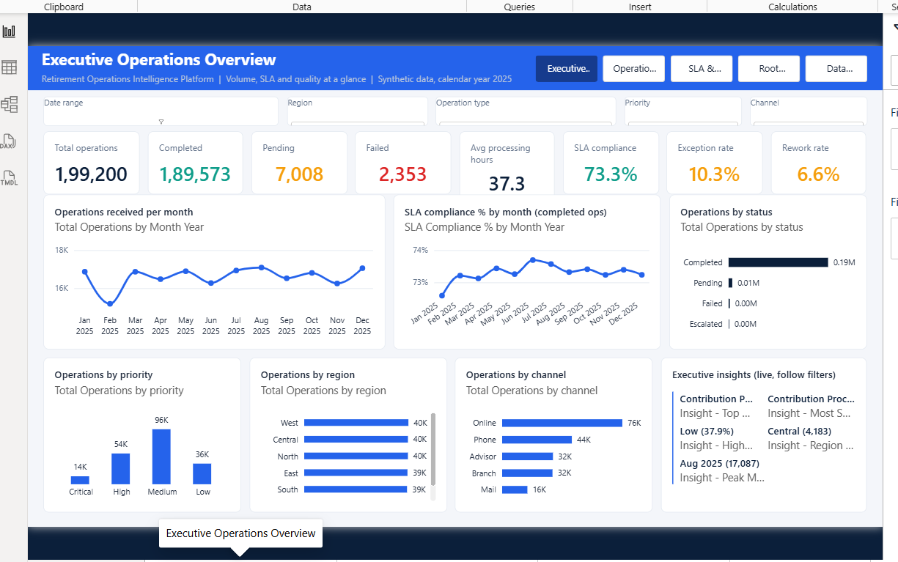
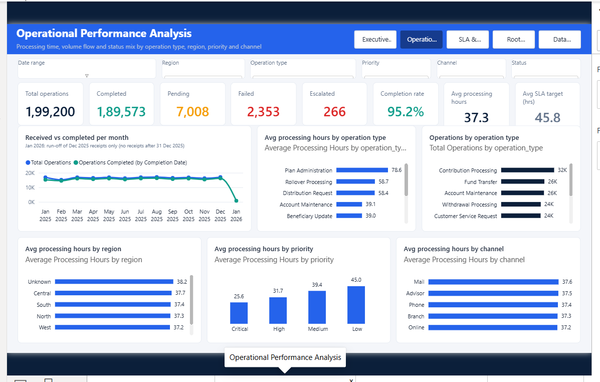
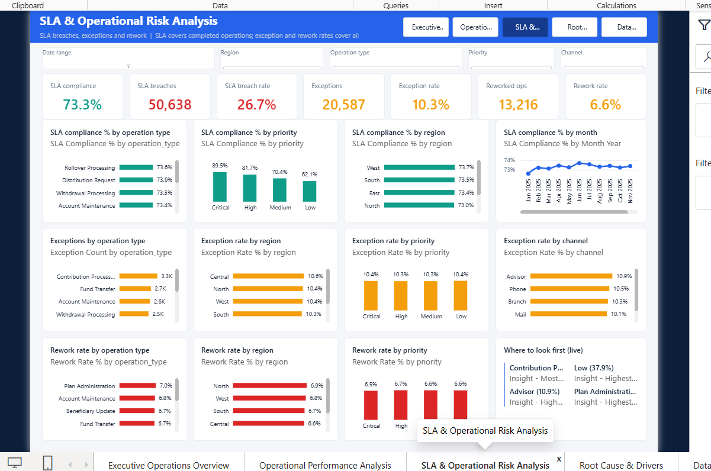
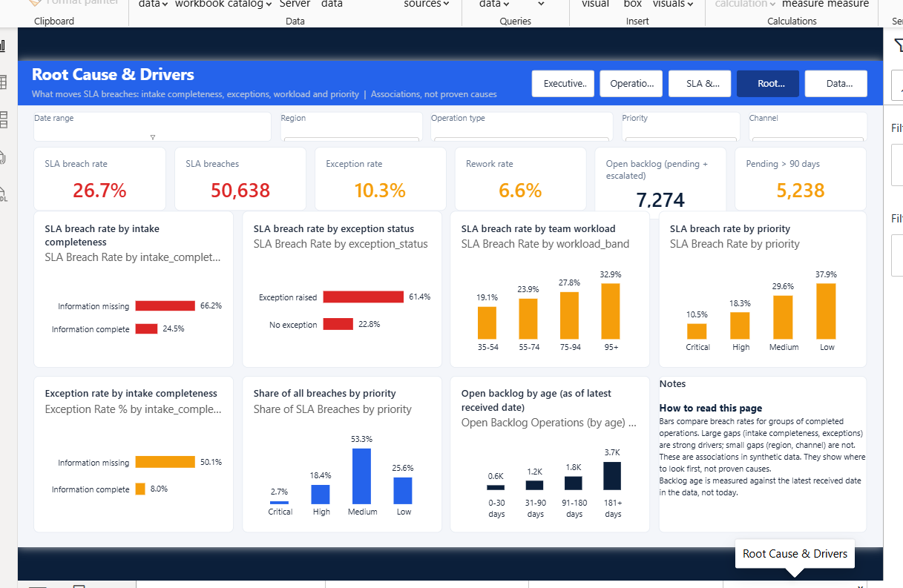
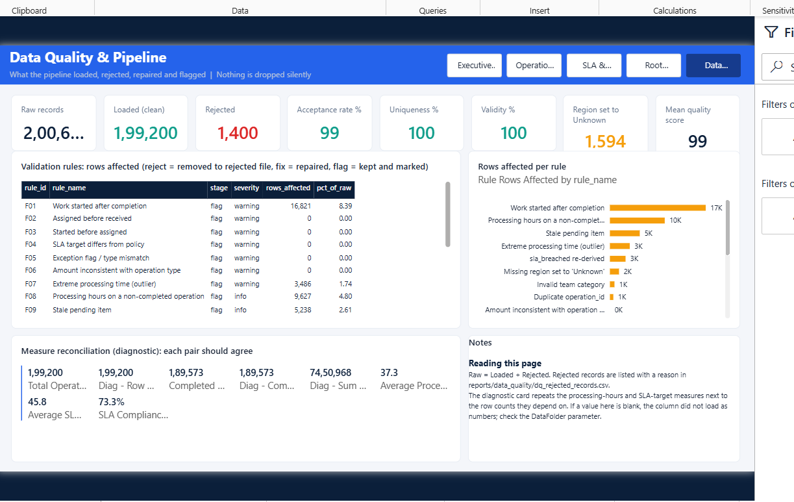

# ROIP - Retirement Operations Intelligence Platform

An end-to-end analytics portfolio project on a **synthetic** retirement-operations dataset: data generation, validated ETL with a data-quality framework, a SQL analytics layer, KPI and root-cause analysis, an SLA-breach risk model, and a 5-page Power BI project.

> All data is synthetic (no real customers, accounts or institutions). Findings describe relationships *built into the simulator* and show the method, not real-world facts. See [docs/BUSINESS_INSIGHTS.md](docs/BUSINESS_INSIGHTS.md).

## Headline results (computed by the code, `reports/kpi_summary.json`)
199,200 operations loaded (1,400 of 200,600 raw records rejected with reasons) - SLA compliance 73.3% - mean processing time 37.3 h (median 26.8 h) - open backlog 7,274 - exception rate 10.3% - rework rate 6.6%.
Biggest SLA-breach associations: exceptions (61% vs 23% breach rate) and missing intake information (66% vs 24%). Team, region and channel show no practical effect.

## Quick start
```bash
python -m venv .venv && source .venv/bin/activate      # Windows: .venv\Scripts\activate
pip install -r requirements.txt
python scripts/run_pipeline.py     # generate -> validate -> clean CSV, rejected CSV, DQ reports
python scripts/run_eda.py          # figures + insight tables
python scripts/train_model.py      # staged SLA-breach model, temporal validation
python scripts/run_sql.py          # run all SQL on DuckDB
python -m pytest -q                # 28 tests
python scripts/validate_powerbi.py # structural check of the .pbip
```
Large CSVs are git-ignored and regenerate deterministically (seed 42). `data/sample/` holds a 500-row sample.

## Repository layout
| Path | What |
|---|---|
| `src/roip/` | `config`, `data_generation`, `dq`, `etl`, `kpis`, `analysis`, `modeling`, `sqlrun`, `utils` |
| `scripts/` | runnable entry points (pipeline, EDA, model, SQL, Power BI validation) |
| `sql/` | `schema.sql`, 19 documented queries in `queries/`, [sql/README.md](sql/README.md) |
| `powerbi/` | PBIP project + the Python generators that produced it |
| `reports/` | KPI JSON, `data_quality/`, `figures/`, `insights/`, `model/`, `sql_results/` |
| `docs/` | KPI dictionary, data quality, data model, insights, ML audit, architecture, Power BI guide, interview guide, audit report |
| `tests/` | 28 pytest tests |

## Key design decisions
- One KPI definition per metric, shared by Python, SQL and DAX, with a test that SQL equals Python. SLA/processing metrics use Completed operations only.
- Nothing dropped silently: rejects go to a file with a rule id; fixes and warnings are logged. `raw = clean + rejected` is asserted.
- The ML model is evaluated on a *later* time window, split by when each feature is known (intake, triage, in-flight), and compared with simple rate-table baselines. It adds modest value over the baselines, and the docs say so.

## What is verified and what is not
Verified here: pipeline reproduces the reference KPIs; 28 tests pass; all SQL runs on DuckDB; the PBIP passes JSON-schema and cross-reference checks. **Not verified:** the PBIP has not been opened in Power BI Desktop in this environment (v3 changes: reworked average measures, two new pages, `ProjectRoot` parameter); DAX not executed; PostgreSQL load not run. Details: [docs/POWERBI_GUIDE.md](docs/POWERBI_GUIDE.md).

## Power BI Dashboard

The Power BI dashboard contains five pages covering executive-level KPIs, operational performance, SLA risk, root-cause analysis, and data quality.

### 1. Executive Operations Overview



### 2. Operational Performance Analysis



### 3. SLA & Operational Risk Analysis



### 4. Root Cause & Drivers



### 5. Data Quality & Pipeline



## Limitations
Synthetic data with designed relationships; `Pending` is assigned at random; no real SLA calendars (business hours, holidays); model ceiling is low because of simulated noise.

## Docs index
[KPI dictionary](docs/KPI_DICTIONARY.md) - [Data quality](docs/DATA_QUALITY.md) - [Data model](docs/DATA_MODEL.md) - [Business insights](docs/BUSINESS_INSIGHTS.md) - [ML audit](docs/ML_AUDIT.md) - [Architecture](docs/ARCHITECTURE.md) - [Power BI guide](docs/POWERBI_GUIDE.md) - [Interview guide](docs/INTERVIEW_GUIDE.md) - [Project audit report](docs/PROJECT_AUDIT_REPORT.md)
